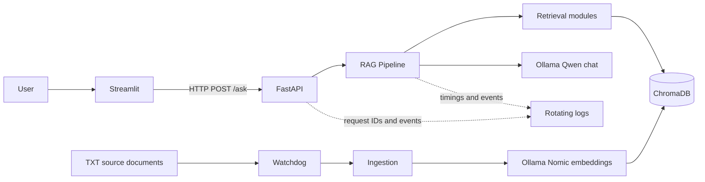
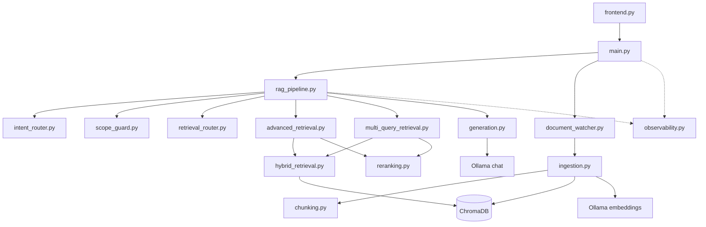
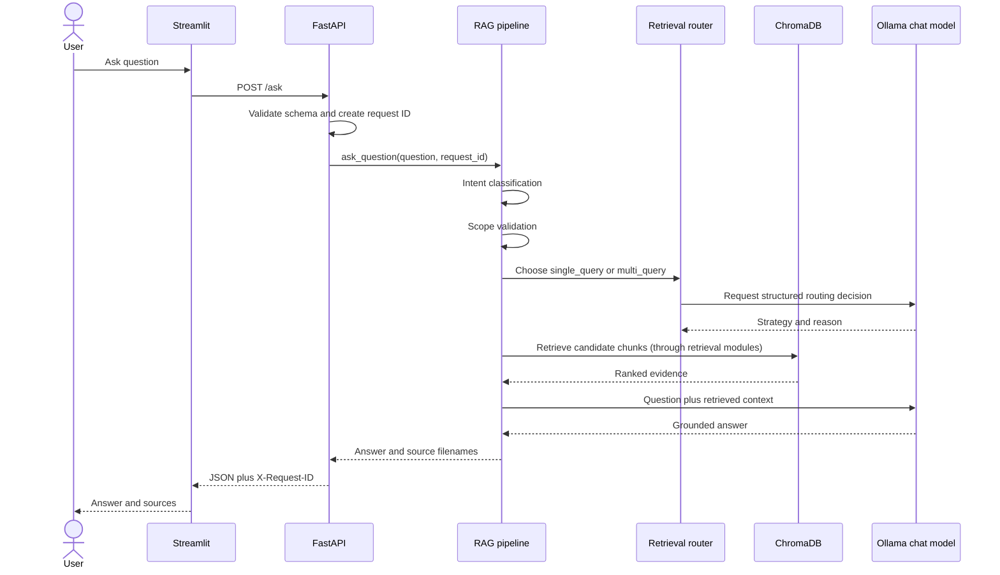
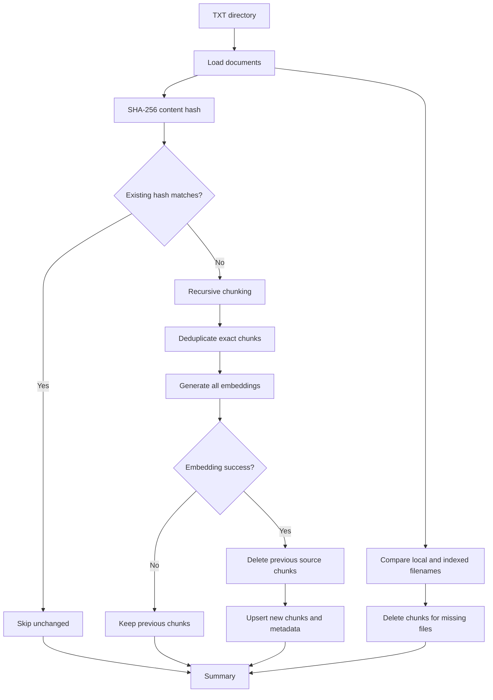
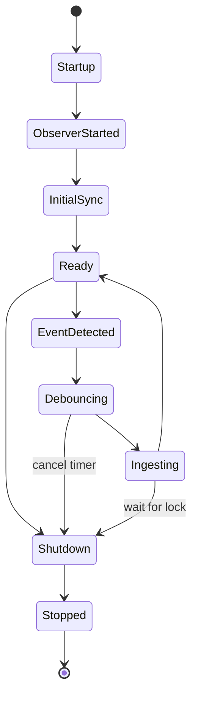
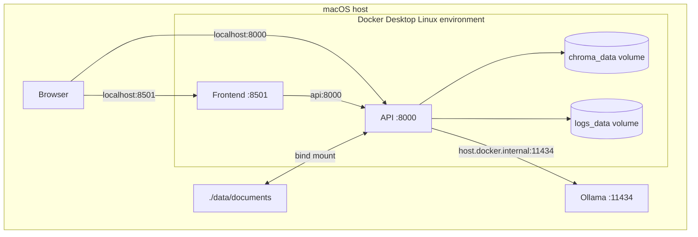

# System Architecture

## Goals and boundaries

The application separates ingestion, retrieval, generation, user interface, API, and observability. Ingestion prepares the knowledge base; query-time retrieval searches it. Retrieval finds evidence; generation writes an answer from that evidence. Routing selects a retrieval strategy and does not itself answer the user.

## System context

In the current Mac Docker setup, API and frontend are Compose services. Ollama is a separately running container reachable from the API through `host.docker.internal:11434`.

## Component relationships

`query_rewriting.py` exists as a standalone utility; the active pipeline does not call its `rewrite_query()` function. Multi-query retrieval has its own query generation and reranking-query preparation.

## Request sequence

## Request stages

1. FastAPI validates `QuestionRequest`.
2. Middleware generates a UUID and starts request timing.
3. `ask_question` delegates to `process_question`.
4. Intent handling short-circuits invalid input and exact greetings.
5. The keyword scope guard checks the configured enterprise domain.
6. LLM routing chooses single- or multi-query retrieval.
7. Retrieval produces candidates, fused rankings, and reranker scores.
8. The pipeline joins selected chunk text into context.
9. Generation uses a grounding-oriented system prompt.
10. Unique source filenames are returned.
11. Middleware logs status and duration and returns `X-Request-ID`.

## Ingestion workflow

Each chunk has an ID `filename_index`, text, vector, and metadata `source`, `chunk_index`, and `content_hash`.

### Replacement safety boundary

All embeddings for a changed file are generated before its existing chunks are deleted. Thus an embedding-generation exception leaves old records intact. ChromaDB deletion and upsert are separate operations, however; a write failure after deletion is not rolled back. This is not a transactional replacement.

## Watcher and FastAPI lifecycle

FastAPI lifespan starts the observer and performs initial sync before serving. At shutdown it stops and joins the observer, cancels pending timer work, and waits for active ingestion. The handler debounces TXT events and serializes watcher-triggered ingestion.

Local testing verified create, modify, delete, and graceful shutdown. Multiple events around one save caused more than one ingestion run in testing; event coalescing remains an improvement.

The watcher is process-local. The current Compose command uses one Uvicorn worker. Multiple workers would each create an observer; a multi-worker deployment should move watching to a dedicated service or add coordination.

## Container architecture

The documents path is a bind mount. ChromaDB and logs use named volumes. A bind mount synchronizes files; it does not itself create embeddings. Watchdog detects the event, ingestion calls Ollama, and ChromaDB receives the vectors.

## Health and readiness

The current `/health` endpoint confirms HTTP application responsiveness. It does not prove Ollama is reachable, models are loaded, the ChromaDB collection exists, or retrieval works. A dependency-aware readiness endpoint is a future improvement.

## Future architecture work

- Versioned or staged ChromaDB replacement for stronger write-failure recovery.
- Dedicated watcher service for multiple API workers.
- Stable-file detection for editors that write temporary files and rename them.
- PDF, DOCX, HTML, and scanned-document ingestion.
- Page/chunk citations.
- Persistent BM25 index or dedicated hybrid search engine.
- Larger retrieval and answer evaluation.
- Dependency-aware readiness checks and metrics.
