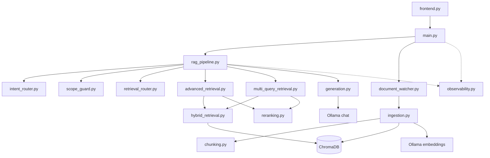

# Code Guide: File-by-File Responsibilities

This guide follows the repository's current modules and explains their inputs, outputs, dependencies, and runtime relationships.

## Application modules

### `app/__init__.py`
Marks `app` as a Python package. It is intentionally empty.

### `app/config.py`
Reads environment-based configuration with local defaults: Ollama URL, chat model, embedding model, document directory, ChromaDB path, and collection name. It allows local Python execution and Docker to use different endpoints and paths without changing application code.

### `app/schemas.py`
Defines Pydantic contracts. `QuestionRequest` requires a non-empty question. `QuestionResponse` contains an answer string and list of source filenames. Used by FastAPI.

### `app/chunking.py`
Defines `chunk_text(text)` using LangChain's `RecursiveCharacterTextSplitter`. Current settings are chunk size 300 characters, overlap 50, and separators from paragraph breaks through individual characters. Input is full document text; output is ordered text chunks. Used by ingestion.

### `app/ingestion.py`
Synchronizes TXT files with ChromaDB.

- `generate_embedding(text)`: calls Ollama `/api/embed`, returns the first vector.
- `load_documents()`: reads sorted TXT files as UTF-8.
- `calculate_content_hash(content)`: computes SHA-256.
- `get_existing_sources(collection)`: maps source filenames to stored hashes.
- `ingest_documents()`: identifies added, modified, unchanged, and deleted files; writes chunks and metadata; returns a summary.

Chunk IDs are `filename_index`. Metadata includes `source`, `chunk_index`, and `content_hash`. Embeddings are generated before old chunks are deleted, protecting the previous version from embedding-generation failure. Delete and upsert are not a single ChromaDB transaction. Run manually with `python -m app.ingestion`. Used by FastAPI startup and the watcher.

### `app/document_watcher.py`
Uses Watchdog to monitor the configured directory. `DocumentChangeHandler` filters TXT events, debounces them with a timer, and serializes watcher-triggered ingestion with a lock. `shutdown()` cancels pending timer work and waits for active ingestion. `start_document_watcher()` starts the observer and returns the observer and handler. Used by FastAPI lifespan.

### `app/retrieval.py`
Basic dense-only retrieval. Embeds a query, queries ChromaDB, and returns ChromaDB results. This is a baseline utility; the main pipeline uses advanced hybrid retrieval.

### `app/hybrid_retrieval.py`
Combines dense ChromaDB search and BM25 lexical search. `tokenize()` creates lowercase tokens. `reciprocal_rank_fusion()` merges ranked lists using reciprocal rank. `hybrid_search()` loads indexed chunks, builds a BM25 index, runs dense search, ranks BM25 results, fuses the lists, and returns candidate dictionaries with ID, text, metadata, and RRF score. BM25 is rebuilt for each call, which is simple but may be costly for a larger corpus.

### `app/reranking.py`
Loads `cross-encoder/ms-marco-MiniLM-L-6-v2` through Sentence Transformers. `rerank_documents()` creates question–passage pairs, predicts scores, sorts descending, and returns top candidates. Scores are ranking scores, not calibrated probabilities.

### `app/advanced_retrieval.py`
Single-query advanced path: hybrid candidate retrieval, Cross-Encoder reranking, optional score filtering, and top-K selection. Called when the router chooses `single_query`.

### `app/query_rewriting.py`
Contains `rewrite_query()`, a standalone LLM-based query rewrite utility. It is not called by the active RAG pipeline. The multi-query module has its own query generation and reranking-query preparation.

### `app/multi_query_retrieval.py`
- `generate_multiple_queries()`: asks the local chat model for distinct search queries.
- `create_reranking_query()`: prepares a query for Cross-Encoder scoring.
- `multi_query_retrieve()`: includes the original question, retrieves for each query using hybrid search, fuses rankings with RRF, reranks candidates, and returns final results.

It adds coverage for multi-part questions at the cost of extra model calls and retrieval work.

### `app/retrieval_router.py`
Asks the local LLM to choose `single_query` or `multi_query`. It parses and validates JSON. Invalid or unsupported output falls back to multi-query. It selects a retrieval path; it does not generate the final answer or execute arbitrary tools.

### `app/intent_router.py`
Rule-based classification into invalid, greeting, or knowledge query. Greetings are recognized from a small exact set after normalization. It is not an LLM classifier.

### `app/scope_guard.py`
Checks for configured enterprise keywords using regular-expression word boundaries. It is a lightweight domain filter, not semantic classification or authorization. It can miss paraphrases and can accept unrelated questions containing a supported keyword.

### `app/generation.py`
Creates an OpenAI-compatible client pointed at Ollama. `generate_answer(question, context)` sends the question and retrieved context to Qwen with a system prompt instructing it to answer only from context, treat context as untrusted, ignore embedded instructions, avoid secrets and unsupported facts, and say when context is insufficient.

### `app/rag_pipeline.py`
Central orchestration. `ask_question()` creates or reuses a request ID, logs start/completion/failure, measures total duration, and calls `process_question()`. The latter handles intent, scope, retrieval routing, retrieval, context construction, generation, and source extraction. Returns `{"answer": ..., "sources": [...]}`.

### `app/observability.py`
Configures console and rotating-file logging. `generate_request_id()` creates a UUID. `log_event(event, request_id, level, **metadata)` emits key-value events. `track_duration()` is a context manager using `time.perf_counter()` to log success or failure duration. Rotation is 1 MB with five backups.

### `app/main.py`
FastAPI application. Lifespan starts the watcher and runs initial ingestion, then stops/joins the observer and shuts down the handler. Middleware creates request IDs, logs API start/completion/failure, measures duration, and returns `X-Request-ID`. `GET /health` returns application status. `POST /ask` validates input and calls the RAG pipeline. Current watcher design assumes one Uvicorn worker.

### `app/frontend.py`
Streamlit chat UI. Stores conversation history in session state, calls `API_URL`, checks `HEALTH_URL`, displays answers and source filenames, handles connection/timeout/HTTP/response errors, and provides a new-conversation action. It does not retrieve documents or call the model directly.

### `app/evaluation.py`
Implements Precision@K, Recall@K, reciprocal rank, and mean reciprocal rank over source identifiers.

### `app/evaluate_retrieval.py`
Loads `data/evaluation_dataset.json`, runs multi-query retrieval, maps chunks to unique source filenames, computes retrieval metrics, and prints aggregate results.

### `app/threshold_experiment.py`
Runs retrieval for each evaluation question, then evaluates multiple Cross-Encoder score thresholds against the same candidate results. Prints precision, recall, and count of questions retaining at least one source.

## Data and root files

| File | Responsibility |
|---|---|
| `data/documents/*.txt` | Synthetic enterprise source documents |
| `data/evaluation_dataset.json` | Questions and expected relevant source filenames |
| `requirements.txt` | Pinned runtime dependencies |
| `Dockerfile` | Python image build instructions |
| `docker-compose.yml` | API/frontend services, ports, environment, mounts, health check, volumes |
| `.dockerignore` | Excludes local environments, caches, Git, data DB, logs, tests, and local tools from build context |
| `.gitignore` | Excludes virtual environments, caches, local DB, logs, and environment files from Git |
| `pytest.ini` | Configures pytest path and test discovery |

## Tests

| Test module | Coverage area |
|---|---|
| `test_advanced_retrieval.py` | Advanced retrieval |
| `test_api.py` | API endpoints and middleware |
| `test_evaluation.py` | Metric calculations |
| `test_generation.py` | Generation and prompt handling |
| `test_ingestion_failure.py` | Preservation when embedding generation fails |
| `test_intent_router.py` | Intent classification |
| `test_multi_query_retrieval.py` | Multi-query behavior |
| `test_observability.py` | IDs, events, timing, rotation |
| `test_rag_intent_integration.py` | Intent integration |
| `test_rag_pipeline.py` | Pipeline orchestration |
| `test_relevance_filter.py` | Relevance filtering |
| `test_retrieval_router.py` | Strategy validation/fallback |
| `test_scope_guard.py` | Scope validation |

## Runtime call map

## Important integration distinctions

- `retrieval.py` is a basic dense baseline; the live pipeline uses advanced/multi-query retrieval.
- `query_rewriting.py` exists but is not called by the live pipeline.
- `retrieval_router.py` is bounded strategy routing, not an unrestricted agent.
- `scope_guard.py` is keyword-based, not semantic.
- Retrieval evaluation measures source-level ranking, not generated answer correctness.
- The ingestion failure test covers embedding-generation failure before deletion, not transactional rollback of ChromaDB writes.
