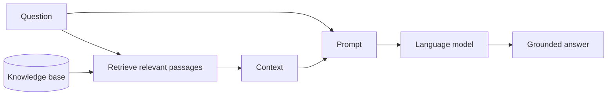
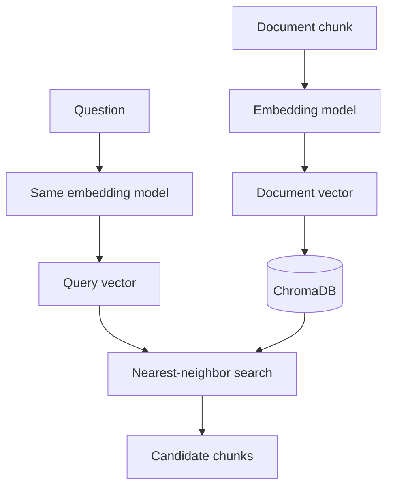
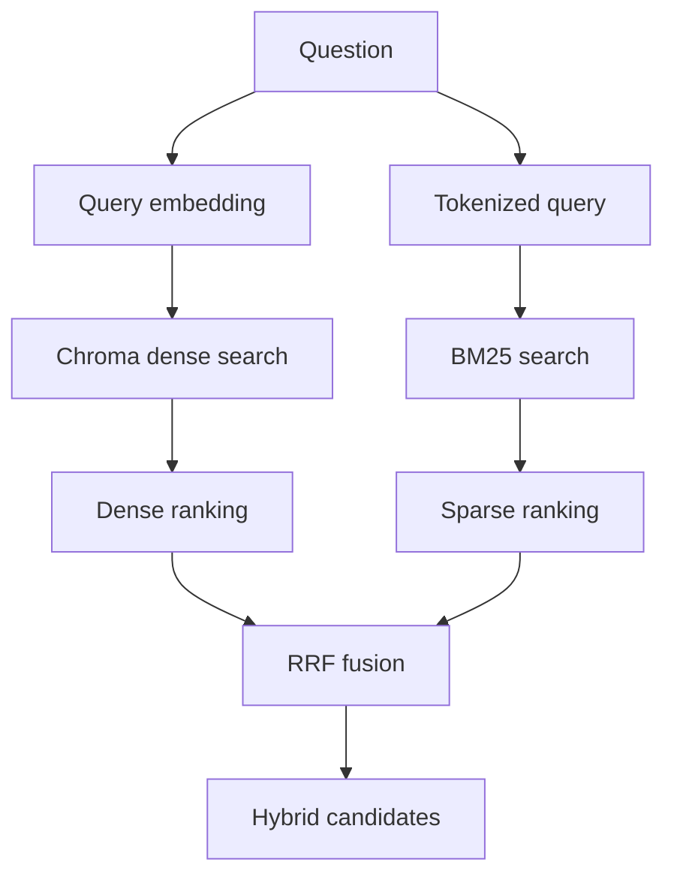
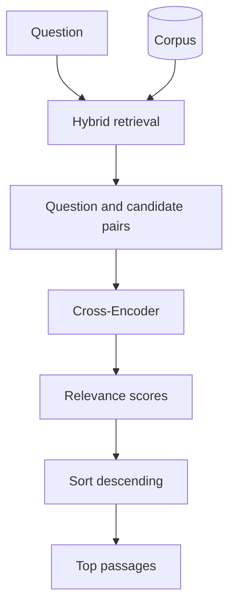
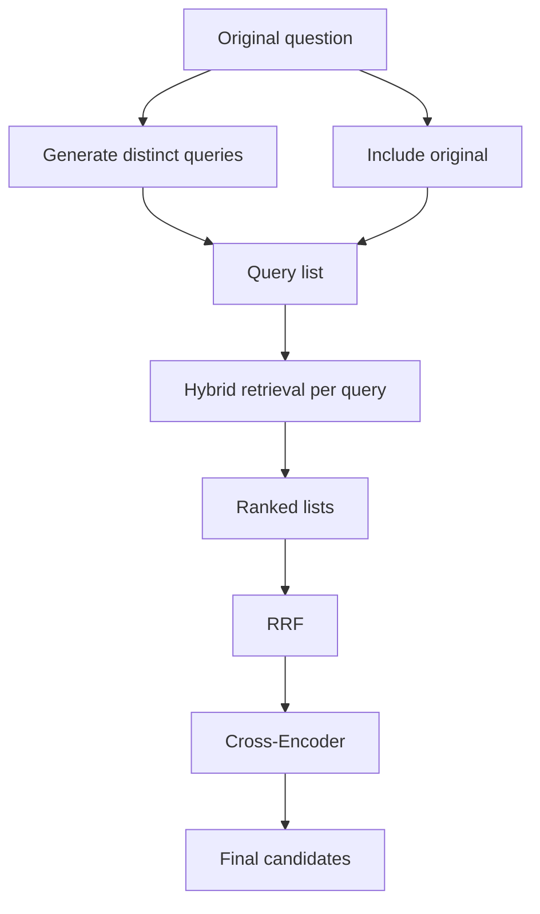

# Concepts and Engineering Decisions

This guide explains the concepts used by the application, why they matter, how they work together, and the trade-offs they introduce.

## 1. Retrieval-Augmented Generation

A language model does not automatically know the current contents of a private enterprise policy folder. RAG retrieves external evidence at query time and provides it to the model as context.



RAG does not fine-tune the model. It supplies information at inference time. It can reduce unsupported responses, but cannot guarantee correctness: retrieval can miss evidence, documents can be wrong, and a model can misinterpret context.

## 2. Chunking and overlap

Chunking divides documents into smaller passages so retrieval can target relevant sections rather than entire files. The project uses LangChain's recursive character splitter with 300-character target chunks and 50-character overlap.

The splitter tries paragraph breaks, line breaks, sentence boundaries, spaces, and finally smaller character splits. This prefers natural boundaries where possible.

Overlap repeats neighboring text across adjacent chunks. It can preserve context when a sentence or condition crosses a boundary.

Trade-offs:
- Small chunks can improve focus but lose surrounding meaning.
- Large chunks preserve context but can introduce irrelevant text and consume more prompt tokens.
- More overlap improves continuity but increases storage and duplicate content.
- Character count is not token count.

The current settings are experimental project choices, not universal best practices.

## 3. Embeddings and vector search

An embedding model maps text into a numerical vector. Semantically related text may be close in the model's vector space.

The project uses `nomic-embed-text` through Ollama. Ingestion embeds document chunks; query-time retrieval embeds the user's question and asks ChromaDB for nearby vectors.



Document and query vectors must use a compatible embedding space. Changing embedding models generally requires re-embedding the corpus. An embedding is not an answer, class label, or probability of correctness.

## 4. Dense retrieval

Dense retrieval uses vector similarity. It can bridge paraphrases: a user may ask "Can I work from home?" while the policy says "remote work arrangements."

It may still miss exact identifiers, unusual names, dates, or terms poorly represented by the embedding model. This motivates lexical retrieval too.

## 5. Sparse retrieval and BM25

BM25 is a lexical ranking method based on query-term frequency, inverse document frequency, and document-length normalization. The project tokenizes chunks and uses `BM25Okapi`.

BM25 is not an embedding model. It is useful for exact terms, acronyms, names, and policy wording, but can miss semantically related passages that share few tokens.

## 6. Hybrid retrieval

Dense and sparse retrieval have complementary strengths.

| Dense | BM25 |
|---|---|
| Semantic similarity | Lexical matching |
| Bridges paraphrases | Strong on exact terms |
| Depends on embedding representation | Depends on tokenization and corpus statistics |



## 7. Reciprocal Rank Fusion

Dense distances and BM25 scores do not share a common scale. Directly adding them can be misleading. RRF combines rank positions:

```text
RRF_score(document) = sum over rankings of 1 / (k + rank)
```

The implementation uses `k=60`. A document ranked highly in several lists accumulates a larger fusion score. RRF scores are ranking values, not probabilities.

## 8. Cross-Encoder reranking

Initial retrieval cheaply finds a broad candidate set. A Cross-Encoder evaluates each question–passage pair jointly, allowing richer token-level interaction. This is more expensive per candidate, so it is applied after retrieval.

The project uses `cross-encoder/ms-marco-MiniLM-L-6-v2`.



A Cross-Encoder score is a model score for ranking, not a calibrated probability. Thresholds must be evaluated on representative data.

## 9. Single-query and multi-query retrieval

A clear one-part question can be searched with one query. A multi-part question may require distinct searches. For example, "Can I work remotely three days a week, and what security rules apply?" requires remote-work eligibility and security requirements.

The multi-query module generates separate search queries, includes the original, runs hybrid search for each, fuses rankings with RRF, then reranks the merged candidates.



Multi-query retrieval can improve coverage but adds latency, model calls, and query-drift risk. Prompts instruct the model to preserve intent and avoid inventing requirements.

## 10. Retrieval routing

The LLM router chooses between `single_query` and `multi_query`. It requests JSON, validates the strategy against an allowlist, and falls back to multi-query if the response is malformed or unsupported.

This is constrained strategy selection, not a general autonomous tool-calling agent.

## 11. Intent and scope

Intent classification handles invalid input, a small exact greeting set, and knowledge queries. Scope validation checks configured enterprise keywords.

The scope guard is a rule-based allowlist, not semantic classification. It can miss valid paraphrases or accept unrelated text containing an allowed word. It is not authorization.

## 12. Grounded generation and prompt injection

The generator receives the original question and retrieved text. The system prompt says to answer only from context, treat retrieved documents as untrusted reference material, ignore instructions embedded in them, avoid secrets and invented facts, and say when context is insufficient.

This is a prompt-level mitigation, not a guarantee. A robust security approach also needs authorization, data filtering, validation, monitoring, and adversarial evaluation.

## 13. Source attribution

The pipeline extracts unique source filenames from final retrieved metadata and returns them with the answer. This gives basic provenance but not exact page numbers, offsets, or chunk citations.

## 14. Content hashes and incremental ingestion

The ingestion pipeline computes SHA-256 over each complete file:
- Matching hash: skip unchanged source.
- New or changed source: chunk and generate embeddings.
- Indexed source missing locally: delete its chunks.

A one-character content change changes the hash. This is content change detection, not semantic versioning.

### Failure behavior

The application generates all new embeddings before deleting old chunks. An embedding-generation failure therefore leaves the old chunks in place. The later ChromaDB delete and upsert are separate operations; a storage failure after deletion is not rolled back. Staged/versioned index replacement is a future hardening step.

## 15. Watchdog, debounce, and lifecycle

Watchdog observes file-system events. The handler filters TXT paths and resets a timer when more events arrive. This debounce attempts to combine bursts caused by editor saves. An ingestion lock serializes watcher-triggered runs.

FastAPI lifespan starts the observer and initial synchronization. During shutdown it stops and joins the observer, cancels pending timer work, and waits for active ingestion.

Local testing verified create, modify, delete, and graceful shutdown. More than one ingestion run was observed around one apparent save, so event coalescing remains an improvement.

## 16. FastAPI lifespan and async execution

FastAPI lifespan manages resources before and after the application serves requests. Code before `yield` starts the watcher and initial sync; code after `yield` stops it.

`asyncio.to_thread()` moves blocking ingestion and thread joins off the async event loop. The current watcher is process-local, so the current single-worker API configuration is intentional.

## 17. Observability and request IDs

A UUID request ID is generated by API middleware and passed into the RAG pipeline. API and RAG events can therefore be correlated. The ID is returned in `X-Request-ID`.

`time.perf_counter()` measures elapsed duration, not wall-clock time. The logger writes to console and a rotating file (1 MB, five backups). This is application logging, not a full distributed tracing or metrics platform.

## 18. Evaluation metrics

The current evaluator compares retrieved source filenames with expected relevant sources.

- Precision@K: relevant items among the top K divided by K.
- Recall@K: relevant items in top K divided by all known relevant items.
- Reciprocal Rank: inverse rank of the first relevant item, or zero if none appears.
- MRR: average reciprocal rank across questions.

The five-question source-level dataset does not measure answer factuality, faithfulness, completeness, citation correctness, or user satisfaction.

## 19. Containers, images, and volumes

A Dockerfile is a build recipe. An image is the packaged template. A container is a running instance of an image.

Compose defines services, networks, ports, environment, mounts, and dependencies. A bind mount maps a host directory into a container; it makes local document edits visible but does not create embeddings. A named volume is Docker-managed persistent storage; the ChromaDB volume survives container replacement.

## 20. Design choices and alternatives

- **ChromaDB:** simple local persistent vector store. Larger production workloads may need managed or distributed vector/search infrastructure.
- **Ollama:** local model runtime and OpenAI-compatible interface. A hosted model endpoint may simplify scaling but changes data, cost, latency, and privacy considerations.
- **BM25 + dense retrieval:** complementary signals. A dedicated search engine can provide integrated hybrid search at scale.
- **RRF:** avoids mixing incompatible raw score scales. Other fusion methods may be evaluated.
- **Cross-Encoder:** improves candidate ordering at additional inference cost.
- **FastAPI + Streamlit:** clear API/UI separation with fast development. A larger product may use a dedicated web frontend.
- **Watchdog in API process:** simple local design. Multi-worker or distributed deployments should use a dedicated watcher/worker and durable job queue.
