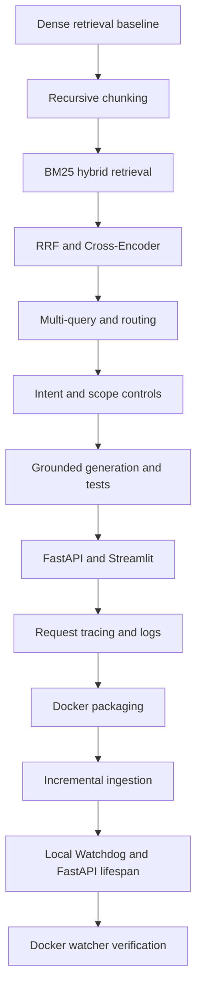

# Development Log: Issues, Decisions, and Fixes

This log records observed symptoms, diagnoses, engineering decisions, fixes, and remaining limits. It distinguishes verified behavior from planned or unverified work.

## Project progression



Docker watcher verification is a separate milestone and must only be marked complete after container-side create, modify, delete, and persistence tests pass.

## Retrieval evolution

### Dense retrieval baseline

The first approach embedded chunks and used ChromaDB nearest-neighbor search. Dense search can bridge paraphrases, but may miss exact policy terms and rare identifiers.

**Decision:** add BM25 as a complementary lexical signal.

### Hybrid search and RRF

BM25 and vector search produce different score types. Directly adding raw scores would assume comparable scales.

**Decision:** combine ranked lists using Reciprocal Rank Fusion, which uses rank positions.

### Cross-Encoder reranking

Initial retrieval returns a broad candidate set. A Cross-Encoder scores query–passage pairs to improve ordering.

**Trade-off:** more inference cost. Scores are ranking scores, not probabilities.

### Multi-query retrieval and routing

Multi-query retrieval expands a question into distinct searches, includes the original question, fuses rankings, and reranks. An LLM router selects between single-query and multi-query strategies and falls back when its response is invalid.

This is bounded retrieval routing, not an unrestricted tool-using agent.

## Intent and scope issue

**Symptom:** "how many leaves do I have?" was rejected as outside the enterprise domain.

**Cause:** the scope keyword set initially included singular "leave" but not plural "leaves".

**Fix:** add the plural term and verify scope behavior.

**Lesson:** keyword allowlists are inexpensive and transparent but vocabulary-sensitive. They are not semantic classifiers.

## Grounding and prompt injection

The generation prompt was strengthened to treat retrieved documents and user content as untrusted data, ignore embedded instructions, avoid revealing secrets/prompts, and avoid unsupported facts.

Generation tests and a manual prompt-injection-oriented test were used. Passing a small set of tests does not prove prompt-injection immunity.

## Evaluation and threshold experiment

The five-question source-level evaluation recorded:

| Metric | Baseline |
|---|---:|
| Precision@3 | 0.47 |
| Recall@3 | 1.00 |
| MRR | 0.90 |

Threshold results:

| Threshold | Precision@3 | Recall@3 | Questions with results |
|---:|---:|---:|---:|
| -5 | 0.47 | 1.00 | 5/5 |
| -3 | 0.40 | 0.90 | 5/5 |
| -1 | 0.40 | 0.90 | 5/5 |
| 0 | 0.33 | 0.80 | 5/5 |
| 1 | 0.33 | 0.80 | 5/5 |
| 2 | 0.27 | 0.70 | 4/5 |
| 3 | 0.27 | 0.70 | 4/5 |

-5 was selected as the current experimental threshold because it preserved the best observed coverage on this small dataset. It is not calibrated for production.

## API observability and lifecycle issues

### Missing request ID during startup

**Symptom:** FastAPI startup failed with `TypeError: log_event() missing 1 required positional argument: 'request_id'`.

**Cause:** the existing `log_event()` signature requires `event` and `request_id`, but the first lifespan implementation omitted the ID on lifecycle events.

**Fix:** generate one lifecycle UUID and pass it to startup and shutdown events. Existing observability and middleware were preserved.

### Local health test reached Docker

A local Uvicorn startup on port 8000 failed, but a health request to port 8000 returned healthy. Docker was already listening on that port, so the response came from Docker rather than the failed local server.

**Fix:** run local Uvicorn on port 8001 and test `http://127.0.0.1:8001/health`.

## Docker and storage issues

### Empty Docker ChromaDB collection

**Symptom:** ChromaDB reported that collection `enterprise_knowledge` did not exist in the API container.

**Cause:** Compose created a new empty named volume. The local Mac database was excluded from the image and was not mounted into the container. Ingestion had not yet run in Docker.

**Fix:** populate the Docker volume by running ingestion inside the API container.

**Lesson:** named volumes are independent persistent stores; they do not copy local ChromaDB data automatically.

### Local document edits absent in Docker

**Symptom:** a new TXT file created on the Mac did not appear inside the API container.

**Diagnosis:** the bind mount had been added in Compose, but the running API container had not been recreated with the updated mount configuration.

**Verification and fix:** `docker compose config` showed the resolved host path and container target. Recreating the API container activated the mount.

### Frontend backend indicator offline

The frontend must call the API using the Compose service address. Its health URL belongs in the frontend environment and uses `http://api:8000/health`, not container-local localhost.

Moving the setting to the frontend and recreating that service made the backend indicator report online.

## Ingestion reliability evolution

### Original behavior

The first ingestion function deleted old chunks before generating replacement embeddings. An embedding failure could therefore lose the prior indexed content. It also did not remove records for deleted source files.

### Content-hash synchronization

The revised implementation computes SHA-256, skips unchanged documents, re-embeds new and changed documents, deletes missing sources, and returns counts for added, modified, unchanged, deleted, and total chunks.

### Observed tests

| Scenario | Observed result |
|---|---|
| Initial sync | 5 documents, 11 chunks |
| Repeat sync | 5 unchanged |
| Modify one file | 1 modified; 12 chunks |
| Delete one file | 1 deleted; 9 chunks |
| Re-add one file | 1 added; 12 chunks |

The first run marked all five files modified because older ChromaDB metadata lacked the new content hash. Subsequent runs skipped unchanged documents.

### Failure test initially did not trigger failure

The first mock test printed a preservation pass, but all documents were unchanged and embedding generation was skipped. The mock was never called.

**Correction:** temporarily modify the test source so its hash changes, patch embedding generation to raise, assert the mock was called, restore the original file in a `finally` block, and compare previous IDs and text.

Observed output:

```text
PASS: Embedding failure was triggered.
PASS: Previous indexed document was preserved.
```

This illustrates why tests must assert that the intended failure path actually executed.

### Remaining storage atomicity limitation

Embeddings are generated before deletion, but ChromaDB delete and upsert are separate operations. A ChromaDB write failure after deletion is not rolled back. Versioned/staged replacement is future work.

## Watcher and FastAPI lifecycle

Watchdog 7.1.0 was added. The handler filters TXT events, debounces them, serializes watcher-triggered ingestion, cancels pending timer work on shutdown, and waits for active ingestion.

FastAPI lifespan starts the observer, performs initial sync, and on shutdown stops and joins the observer and shuts down the handler.

Local verification:
- API startup completed.
- Initial sync skipped five unchanged documents.
- Create event indexed a new test file.
- Modify event updated it.
- Delete event removed its chunks.
- Ctrl+C produced startup/shutdown lifecycle logs and graceful completion.

Multiple ingestion runs occurred around one apparent creation event. Final data was correct, but duplicate event coalescing remains an improvement.

## Issue summary

| Issue | Root cause | Fix / decision | Remaining limit |
|---|---|---|---|
| Exact terms missed | Dense-only retrieval | Add BM25 + RRF | Tokenization and corpus scale |
| Ranking needed refinement | Broad candidate set | Cross-Encoder | Score calibration |
| Multi-part questions | One search query insufficient | Multi-query retrieval | Latency and query drift |
| Leave plural rejected | Missing keyword | Add `leaves` | Keyword guard limitations |
| Docker collection absent | New empty named volume | Ingest in API container | Separate local/container DB |
| Local file not visible | Container lacked refreshed mount | Recreate API with bind mount | Host event behavior |
| Frontend health offline | Wrong/missing frontend URL | Configure frontend health URL | Health is shallow |
| Old chunks at risk | Delete before embedding | Generate embeddings first | Delete/upsert not transactional |
| Failure test false positive | Mock not called | Force content change and assert call | Chroma write failure untested |
| Lifespan startup failed | Missing request ID | Add lifecycle UUID | Specific bug resolved |
| Local curl hit Docker | Port collision | Test local API on 8001 | Keep endpoints distinct |
| Repeated watcher ingestion | Multiple filesystem events | Debounce and serialize | Coalescing can improve |

## Verified versus pending

### Verified locally

- Add, modify, unchanged, and delete ingestion behavior.
- Preservation of old chunks on embedding-generation failure.
- Local Watchdog create/modify/delete behavior.
- FastAPI startup, initial sync, and graceful shutdown.
- Local health endpoint on port 8001.

### Docker-side verification completed / remaining

Verified:
- Docker image build completed successfully after switching the API image to CPU-only PyTorch.
- PyTorch inside the API container reported `2.15.0+cpu`; CUDA was unavailable as expected.
- `sentence_transformers.CrossEncoder` imported successfully inside the API container.
- API container reached healthy status.
- Host bind-mount create event reached the API container watcher and indexed the test document; collection count moved to six documents and 13 chunks.
- Host delete event reached the watcher and removed the test document; collection returned to five documents and 12 chunks.

Not separately verified in this milestone:
- Docker-side modify event.
- ChromaDB named-volume persistence across API container recreation.
- A formal Docker-side graceful-shutdown assertion beyond observing normal container lifecycle logs.

The latest reported local automated test run completed with 61 tests passed.
