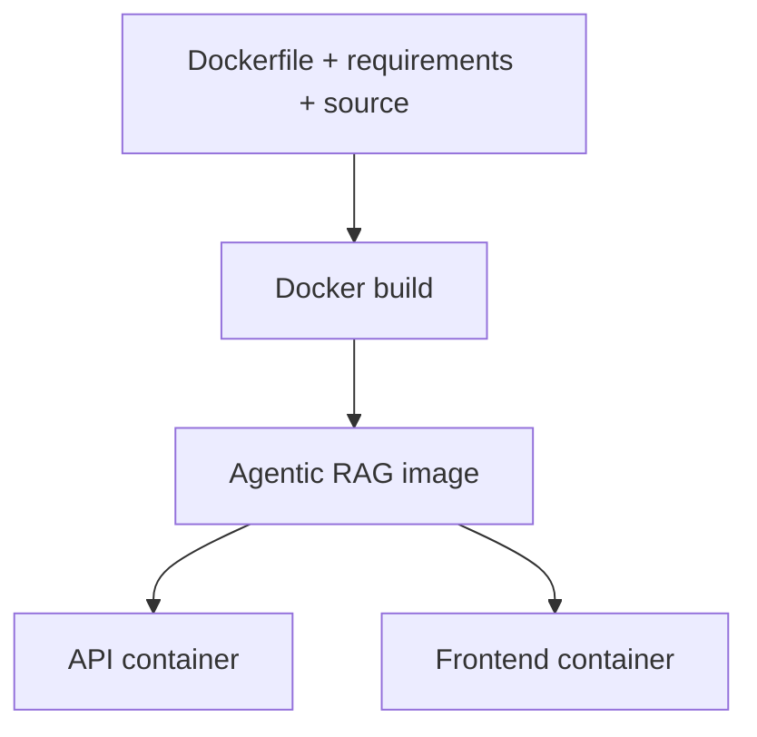
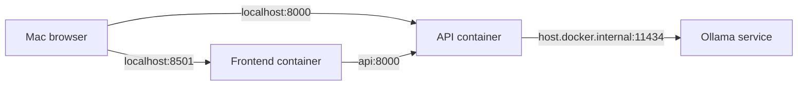

# Docker Operations and Runtime Guide

## 1. Dockerfile, image, and container

- **Dockerfile:** build instructions.
- **Image:** reusable packaged template created from those instructions.
- **Container:** running instance of an image.



The API and frontend use the same application image but different commands.

## 2. What the Dockerfile does

The repository Dockerfile starts from `python:3.12-slim`, sets Python runtime flags, chooses `/app` as the working directory, installs build tools, copies requirements and installs packages, copies application code and sample documents, creates runtime directories, exposes ports, and defaults to Uvicorn. Compose overrides the command for Streamlit.

Copying requirements before source code allows Docker to reuse the dependency layer when only application code changes.

## 3. Compose services

| Service | Purpose | Host port |
|---|---|---:|
| `api` | FastAPI and document watcher | 8000 |
| `frontend` | Streamlit UI | 8501 |

Ollama is a separately running container in the current Mac development setup. The API reaches it via `host.docker.internal:11434`.

## 4. Networking

Compose creates a network where services resolve by service name. The frontend calls:

```text
http://api:8000/ask
http://api:8000/health
```

Inside a container, `localhost` refers to that container itself. It does not mean the host or another container.



## 5. Bind mounts and named volumes

### Bind mount: source documents

```yaml
- ./data/documents:/app/data/documents
```

The host directory is visible at the target path in the API container. Local file changes appear without rebuilding the image.

### Named volume: ChromaDB

```yaml
- chroma_data:/app/data/chroma_db
```

Docker manages this storage independently of the API container. It persists across container recreation.

### Named volume: logs

```yaml
- logs_data:/app/logs
```

Keeps logs outside the container's writable layer.

```mermaid
flowchart TD
  HOST[Mac data/documents] <-->|bind mount| TARGET[/app/data/documents]
  TARGET --> WATCH[Watchdog]
  WATCH --> ING[Ingestion]
  ING --> DB[(chroma_data volume)]
  API[API container] --> LOG[(logs_data volume)]
```

A bind mount synchronizes files but does not generate embeddings. Watchdog detects a change, ingestion calls Ollama, and ChromaDB stores the vectors.

## 6. Build and start

```bash
docker compose config
docker compose up -d --build
docker compose ps
```

Force recreation after dependency or runtime changes:

```bash
docker compose up -d --build --force-recreate api
```

## 7. Inspect services

```bash
docker compose ps
docker compose logs -f api
docker compose logs -f frontend
docker compose exec api pip show watchdog
curl http://localhost:8000/health
```

## 8. Verify the bind mount

Create a local test file:

```bash
echo "Docker bind mount test." > data/documents/docker_test.txt
```

Check inside the container:

```bash
docker compose exec api ls -la /app/data/documents
```

If it is absent, inspect the resolved Compose configuration:

```bash
docker compose config
```

Under `api.volumes`, verify the local source points to the project's `data/documents` and target is `/app/data/documents`.

## 9. Verify ChromaDB

```bash
docker compose exec api python -c "import chromadb; c=chromadb.PersistentClient(path='/app/data/chroma_db'); print(c.list_collections())"
```

```bash
docker compose exec api python -c "import chromadb; c=chromadb.PersistentClient(path='/app/data/chroma_db'); col=c.get_collection('enterprise_knowledge'); print('Chunks:', col.count())"
```

Inspect one source:

```bash
docker compose exec api python -c "import chromadb; c=chromadb.PersistentClient(path='/app/data/chroma_db'); col=c.get_collection('enterprise_knowledge'); print(col.get(where={'source':'docker_test.txt'}, include=['documents','metadatas']))"
```

## 10. Manual ingestion

```bash
docker compose exec api python -m app.ingestion
```

With the watcher running, normal TXT changes should trigger ingestion automatically. Manual ingestion remains useful for initial population and troubleshooting.

## 11. Stop and persistence

```bash
docker compose down
```

This removes containers and the Compose network but leaves named volumes by default.

**Destructive reset:**

```bash
docker compose down -v
```

The `-v` option removes named volumes, including ChromaDB and logs. Do not use it unless intentionally deleting that persistent data.

## 12. Docker watcher verification checklist

1. API becomes healthy.
2. Logs show watcher startup.
3. Initial sync completes.
4. Add a TXT file locally.
5. Confirm the file is visible inside the API container.
6. Confirm watcher logs report the event.
7. Confirm ChromaDB contains the new source.
8. Modify and verify updated chunks.
9. Delete and verify source chunks disappear.
10. Recreate the API container and verify ChromaDB volume persistence.

Record actual test output in the development log. A successful image build alone does not prove watcher functionality.

## 13. Operational limitations

- Current watcher assumes one API process; multiple Uvicorn workers create multiple observers.
- Health check confirms HTTP responsiveness, not all dependencies.
- Bind-mount event delivery can vary across Docker Desktop and host versions.
- An event can arrive before a file write is complete; debounce reduces but does not formally eliminate that race.
- ChromaDB writes are not transactional with filesystem events.
